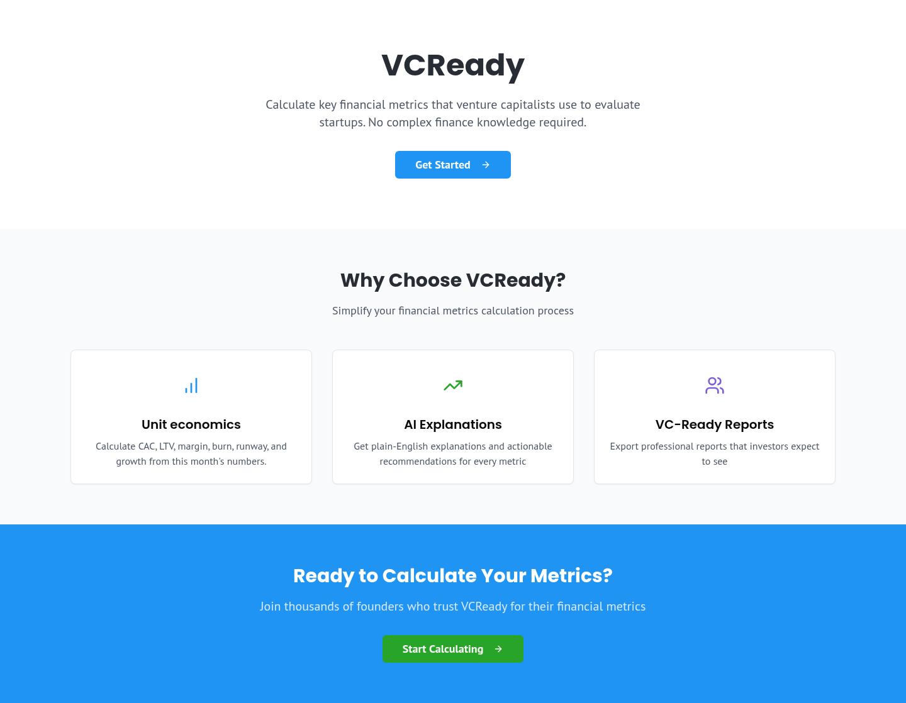
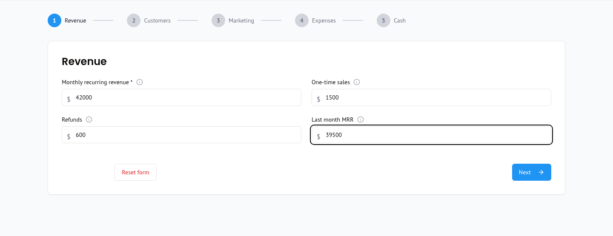
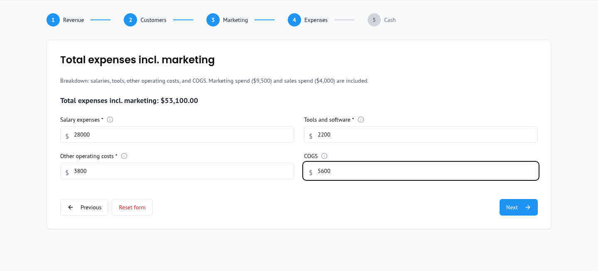
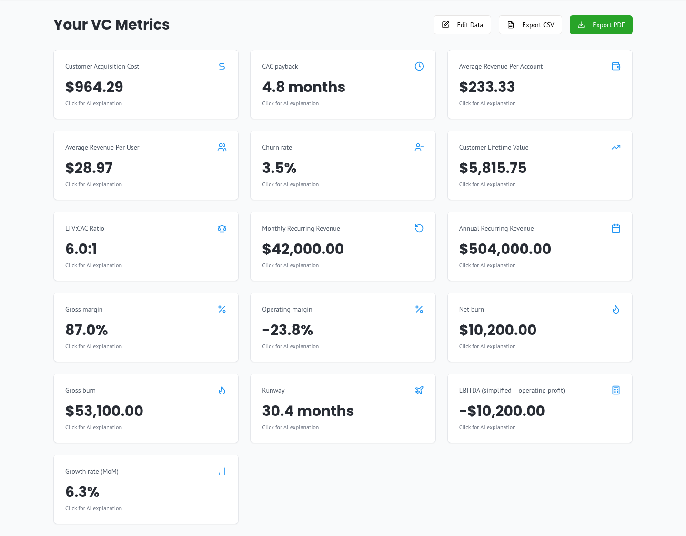
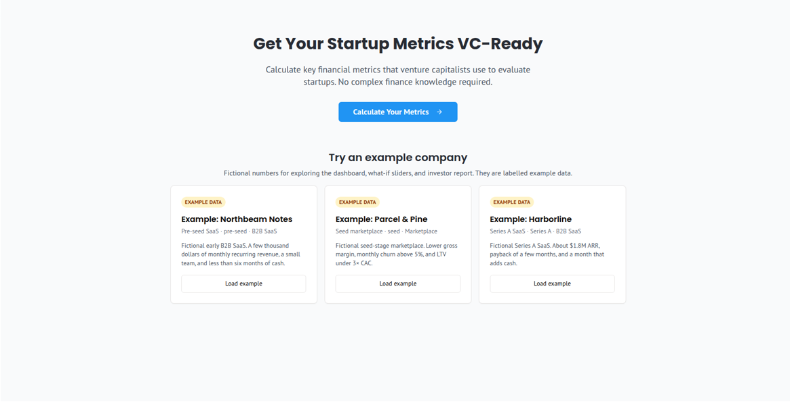
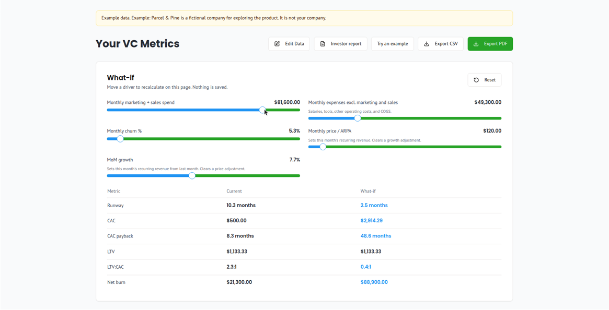
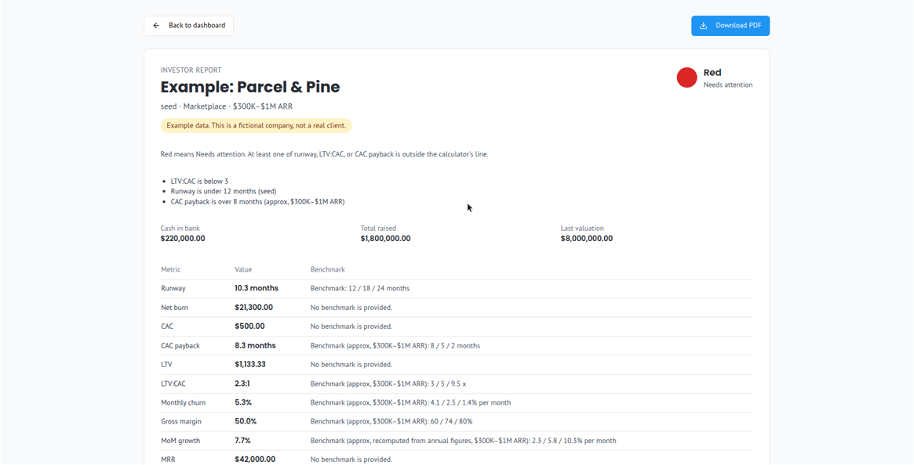

# VCReady

**Calculate the financial metrics venture capitalists use to evaluate startups — without needing a finance background.**

> **Status:** Fully built web application, not publicly launched. Source code is private; available on request.

**Timeline:** Project, 2025

## Screenshots

**Landing page**

**Guided data-entry wizard**

**Metrics dashboard**

**Sample startups**

**What-if sliders**

**One-page investor report**

## Key features

- **Guided data-entry wizard** for revenue, customers, marketing, expenses and cash.
- **Dashboard of SaaS and startup metrics:** MRR, burn, runway, CAC, CAC payback, LTV, LTV:CAC, churn and gross margin.
- **Stage- and ARR-band benchmarks** with sources shown in tooltips.
- **AI explanation of each metric**, in plain language, on click.
- **What-if sliders** to recalculate runway, CAC, CAC payback, LTV, LTV:CAC and net burn on the page, without saving changes.
- **One-page investor report** with a traffic-light status and 3 AI tips, ready to download or print.
- **Sample startups** (Northbeam Notes, Parcel & Pine and Harborline) with fictional figures, so you can explore the dashboard, sliders and report.

## Tech stack

From the project's `package.json`:

- **Frontend:** React, Vite, TypeScript, Tailwind CSS
- **Backend:** Node.js with Express
- **Database:** PostgreSQL with Drizzle ORM
- **AI explanations:** OpenAI-powered

## My role

Product idea, design and full-stack build by Bakhytzhan Ibrayev.

## Source code

The source code is private and is not included in this repository. It is available on request.
